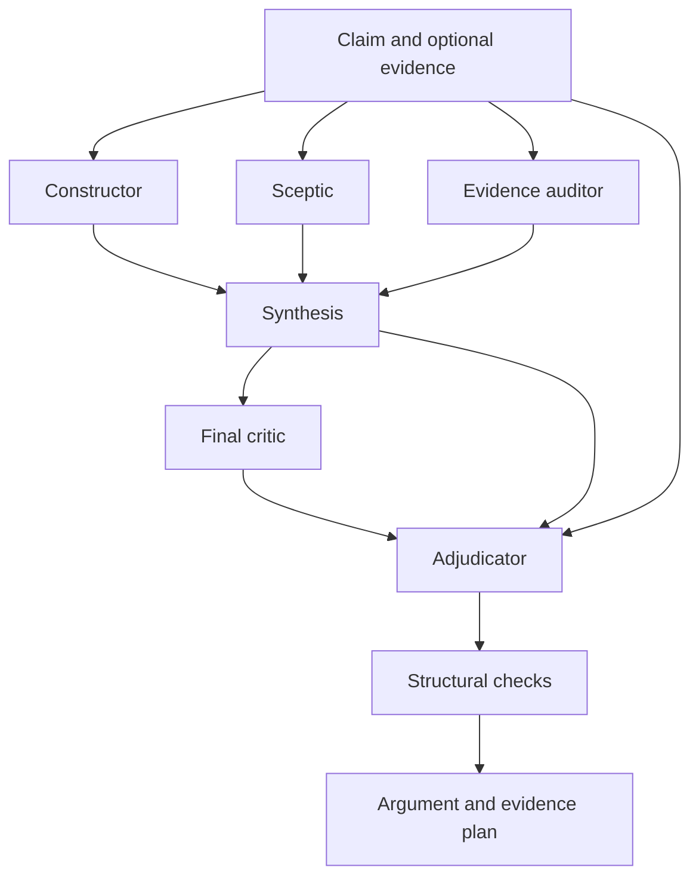

# EngArg

A Rust command-line tool that develops the strongest defensible engineering argument it can construct from a claim. Give it the claim and it builds an extended Toulmin argument, examines the consequential objections and specifies the evidence needed to establish its premises and warrants. Context and evidence are optional.

For a claim alone, EngArg develops a substantive conditional argument with explicit mechanisms, premises, working scope and assumptions. It then explains what evidence would support, weaken or overturn that argument. The distinction between a coherent candidate and an established conclusion remains visible through the claim qualifier and assessment status. LLM construction and critique provide candidates for review, with their limits and unresolved obligations retained.

## Try it

Install the pinned Rust toolchain using [rustup](https://rustup.rs/). A C compiler is required by the TLS dependencies. From this directory:

```sh
cargo install --path . --locked
engarg demo --claim-only --format markdown
engarg demo --format outline
engarg demo --format prose
engarg schema request
engarg validate --input examples/request.json --case examples/case.json
```

The demo is synthetic and makes no model calls. `engarg demo --claim-only` shows a complete argument and evidence plan starting from the minimal request in `examples/claim-only-request.json`. Omit `--claim-only` to inspect an example with an optional source record.

For a provider run, set `ENGARG_API_KEY` through your secret manager or environment, and set `ENGARG_MODEL` to an exact model identifier supported by that endpoint. Then:

```sh
engarg analyse \
  --claim 'Parallelising independent CI test groups reduces pipeline duration without changing test outcomes.' \
  --model "$ENGARG_MODEL" \
  --format json \
  --audit run.audit.jsonl \
  --output run.json
```

The default endpoint is OpenAI's Responses API. To use an existing `OPENAI_API_KEY`, select its environment variable name with `--api-key-env OPENAI_API_KEY`. Keys never belong in command-line arguments or input JSON. Claim text, evidence and prior assessments are sent to the configured provider. The adapter sends `store: false`; provider-specific retention and deployment policies remain outside this program.

To request GPT-6.1 Sol with Ultrafast processing through the Responses API:

```sh
engarg analyse \
  --claim 'Parallelising independent CI test groups reduces pipeline duration without changing test outcomes.' \
  --model gpt-6.1-sol \
  --service-tier ultrafast \
  --reasoning-effort high \
  --format json \
  --audit run.audit.jsonl \
  --output run.json
```

`--service-tier` also reads `ENGARG_SERVICE_TIER`. The adapter passes the requested value unchanged and records it in the audit. Each completion records the tier returned by the provider when present. An omitted returned tier remains unknown. EngArg preserves the requested model and tier and reports API errors explicitly, so an unsupported combination is visible. Provider availability, entitlement, pricing and rate limits apply. OpenAI documents this combination in the [GPT-6.1 Sol model guide](https://developers.openai.com/api/docs/models/gpt-6.1-sol) and [Ultrafast mode guide](https://developers.openai.com/api/docs/guides/ultrafast-mode). Compatible endpoints must support the supplied `service_tier` value themselves.

Reasoning effort is optional. Use `--reasoning-effort VALUE` or set `ENGARG_REASONING_EFFORT`. For `gpt-6.1-sol`, official OpenAI documentation lists `low`, `medium` (the model default), `high`, `xhigh` and `max`. That model does not support `none` or `minimal`. See the [model guide](https://developers.openai.com/api/docs/models/gpt-6.1-sol) and [reasoning guide](https://developers.openai.com/api/docs/guides/reasoning).

The Responses adapter sends `reasoning: {"effort": "VALUE"}`. The Chat adapter sends `reasoning_effort: "VALUE"`. An unset option sends neither field, so models without configurable reasoning retain their existing behaviour. The configured value applies to every stage, including per-role model overrides. Select an effort supported by each model used in that run. The endpoint validates model compatibility. Rejected combinations fail explicitly, and EngArg preserves the requested value without substituting another effort or retrying with it removed. Provider-specific identifiers are passed unchanged after bounded identifier validation.

The audit start record and saved report record `requested_reasoning_effort`. Each completion records `reasoning_effort` only from provider-reported metadata, with an unknown value when absent. These records describe configuration and reported settings, rather than a measurement of internal computation or argument quality. Existing saved reports without these fields remain readable. Rust library callers must initialise the new optional configuration field when constructing `HttpConfig` directly.

Reasoning tokens share OpenAI's output-token allowance with the visible argument. Existing token and time limits still apply. Adjust `--max-output-tokens`, `--request-timeout-secs` and `--timeout-secs` for your chosen workload when necessary. EngArg keeps these budgets explicit.

For an OpenAI-compatible Chat Completions endpoint that implements strict JSON Schema:

```sh
engarg analyse \
  --claim 'The proposed cache reduces p95 request latency under the declared workload.' \
  --model YOUR_MODEL_ID \
  --format json \
  --api chat \
  --endpoint http://localhost:8000/v1/chat/completions \
  --audit cache.audit.jsonl \
  --output cache.json
```

HTTP is permitted on loopback only. Other destinations require HTTPS. Compatible endpoints must implement `json_schema`, `strict`, the selected token-limit field and `store`; the client fails explicitly when the endpoint rejects the contract. There is no silent fallback to unconstrained text.

Use `--role-model sceptic=MODEL_ID` or `--role-model adjudicator=MODEL_ID` to use different models through the same endpoint. Valid role names are `constructor`, `sceptic`, `evidence_auditor`, `synthesiser`, `final_critic`, `adjudicator` and `single`. Independent calls do not imply independent model errors.

The default hybrid workflow performs six calls. `--mode single --max-calls 1` supplies an inexpensive evaluation baseline. Choose model identifiers explicitly rather than relying on a model alias embedded in the executable.

## Generation depth and invalid-output recovery

Use `--argument-depth N` to limit the generated support graph to N warrant layers on every path from `current_claim` or `stronger_target` to a ground. A direct claim → warrant → ground argument has depth 1. Introducing an intermediate subclaim adds one layer. The limit applies to all candidate routes, including unselected alternatives. It is sent to every agent and checked deterministically against the final graph. Allowed values are 1–16. Omit the option to retain the previous unbounded decomposition behaviour, subject to the other resource limits.

At the depth boundary, the argument must state the remaining premises as assumed or missing grounds with concrete evidence obligations. Depth bounds decomposition, not breadth, verbosity, truth or argument quality. It does not permit invented evidence, concealed conditions or unresolved objections without plans. For example, start with:

```sh
engarg analyse --claim 'YOUR CLAIM' --model gpt-6.1-sol \
  --service-tier ultrafast --reasoning-effort high \
  --api-key-env OPENAI_API_KEY \
  --argument-depth 2 --max-repairs 1 --max-calls 7 \
  --format json --audit depth2.audit.jsonl --output depth2.json
```

The error `unresolved material defeater auditor-5 needs an evidence plan` means that the model returned an open or sustained material objection without an evidence-plan item whose `target_id` is exactly `auditor-5`. A plan targeting the attacked claim or warrant does not cover the objection itself. The validator deliberately keeps this requirement. Adjudication now receives the draft's validation errors, and fixed instructions explicitly require a plan for every unresolved material defeater.

`--max-repairs N` permits up to N additional calls to correct invalid final model content, with the original request, complete candidate, retained objections and exact validation diagnostics. It defaults to 0 and accepts 0–3. The call budget must reserve the allowance before any call: hybrid with one repair requires `--max-calls 7`; single mode with one repair requires at least 2. Unused repair allowances make no calls. More `--max-calls` alone does not activate repairs or more debate rounds.

Repairs use the same model role, reasoning settings, byte, output-token and deadline limits. Every correction is fully validated, and every completed call is audited. Repairs must retain objection identifiers and wording, and cannot downgrade an existing material objection to nonmaterial. A specific justified revision can still make a challenge inapplicable. The model must supply the investigation: EngArg does not fabricate a generic evidence plan or silently waive a failed check. Exhausting the repair allowance still fails explicitly. Provider errors, refusals, truncation and resource failures do not trigger repairs. This facility corrects structural output defects; it cannot establish evidential adequacy or guarantee useful reasoning.

`DISSENT_TARGET_CHANGED` identifies a retained objection whose scope or target fields changed after first attachment. The diagnostic names those fields. Restore them from `retained_objections[].identity.target_context` when correcting an unrelated defect, keeping an unresolved challenge open. Use `inapplicable_after_revision` only when the specific revision removes the challenge, with an explanation in `response`. Exact text comparison is conservative: EngArg cannot establish that rewritten propositions mean the same thing. Evidence, support status and assumption investigation plans can change without replacing the target. Reordering jointly required premises or assumption attachments also preserves target identity. A target missing from an invalid candidate acquires its context when supplied; its identifier, attack kind, basis and known scope remain fixed.

To explore further decomposition later, rerun the same claim with `--argument-depth 4` and new output/audit filenames. This is a fresh assessment, not a continuation or automatic merge of the previous graph. Greater permitted depth does not guarantee greater actual depth or a stronger argument. Compare the reasoning and obligations, and supply acquired evidence when available. Display depth can instead change freely without inference, as shown below. Saved reports and audit start records retain the generation and repair settings. Old saved reports remain readable.

## Token use

Version 0.5.1 reduces repeated model context automatically, with the same six-stage hybrid workflow, model settings and complete final argument. Existing analyse commands receive the optimisation without another option.

Shared construction and evidence rules are stated once. The constructor, sceptic and evidence auditor receive the assessment output contract, while case writers and the final critic retain the complete graph/prose contract. Composition rules remain available to every role. Assessment entries ask for substantive plain-language reasoning rather than JSON records encoded inside strings, with no new cap on technical detail.

Later prompts keep each objection's exact wording once in `retained_objections`. The register includes objections introduced during synthesis and preserves materiality through adjudication and repair. A revision can explain a changed disposition while retaining the challenge. Assessment `objection_ids` and exact duplicate draft challenges refer to that same request-local register. A repeated original claim can refer to `request.claim`. Findings, evidence gaps, source evidence and the full draft graph and reading remain available. References are substituted only when their encoded JSON fields are smaller. Mismatched claims or objection wording stay literal for review. Complete model outputs still require the original literal fields and pass all existing checks. No model summary or extra retrieval call replaces source content.

A typed repair candidate is sent as a structured object rather than an escaped JSON string. Invalid or duplicate-key candidate text remains verbatim for diagnosis. Original completion receipts are retained in the audit, and call, time, byte and output-token limits apply as before.

A fixed-output comparison against `db92e30` measured **17.3% fewer input reference tokens** across five workloads. In the retained seven-call run, input fell from 115,178 to 95,536 reference tokens. The final arguments and completion sequences were identical. These measurements use `tiktoken 0.14.0` with `o200k_base`; they exclude proprietary framing, cached token accounting and hidden reasoning. They demonstrate context reduction and preserved replay acceptance, with live-model quality and billing effects still to be measured. See [EVALUATION.md](EVALUATION.md) and the [raw measurements](benchmarks/token_usage.json).

Keep a complete JSON report for subsequent inspection. When passing Markdown to another model, `--no-audit-appendix` retains every argument record and shared register while omitting the full JSON transcript appendix:

```sh
engarg render --input run.json --format markdown --no-audit-appendix --output argument.md
```

The retained report measured 283,686 reference tokens with its audit appendix and 60,461 without it, a 78.7% reduction in downstream document context. The canonical source remained unchanged. This option affects Markdown presentation rather than the inference that constructed the argument. The full appendix remains the default. `--format prose` provides the existing connected reading view.

## Input and output

Only `claim` is required. The simplest JSON input is:

```json
{
  "claim": "Parallelising independent CI test groups reduces pipeline duration without changing test outcomes."
}
```

Use `--claim TEXT` directly or save that object and pass it with `--input FILE`. Omitted `context` and `evidence` default to an empty string and array. The tool derives proposed working definitions and scope, builds the argument, tests alternatives and gives each unmet premise, critical assumption and warrant-backing gap an evidence or reasoning obligation. Each obligation identifies the affected inference, the investigation, comparison, measurement, proposed acceptance criterion and consequence of an adverse or inconclusive result.

When useful, add free-text `context` or optional `evidence` records to refine the argument. Each evidence record supplies a stable `id`, `title`, `source`, `excerpt`, `kind` and `checked_by_user` assertion. Include adverse evidence alongside supporting evidence. A source URL records provenance. Put its actual relevant passage or measurement summary in `excerpt`, with revision identifiers, configuration details and units where available. For example:

```json
{
  "claim": "The change improves throughput under workload W.",
  "context": "Service revision A versus B, identical hardware and workload W.",
  "evidence": [
    {
      "id": "E1",
      "title": "Benchmark report",
      "source": "benchmark/report.json at revision REVISION",
      "excerpt": "Insert actual measurements, repetitions, uncertainty and configuration here.",
      "kind": "benchmark_report",
      "checked_by_user": false
    }
  ]
}
```

The expanded object illustrates the optional source format. Use actual artefacts when adding evidence. Claim-only construction works without this object or any source record.

The argument contains:

| Toulmin component or extension | Representation |
| --- | --- |
| Claim and qualifier | Original wording, current defensible formulation, stronger conditional target |
| Grounds | Required premises distinguished as assumed, missing or reported with evidence |
| Warrant and backing | Inference, applicability and required backing, with available evidence linked when supplied |
| Intermediate reasoning | Subclaims and an acyclic dependency graph |
| Assumptions | Criticality, support status, affected nodes and validation needs |
| Rebuttals and other attacks | Undermining, rebutting and undercutting, with targets, basis, materiality and disposition |
| Engineering scope | System boundary, configuration, operating conditions, units, time horizon and consequences |
| Alternatives | Competing explanations and discriminating tests |
| Evidence acquisition | Method, measurement, comparator, acceptance criterion, enabled claim, failure interpretation, priority and effort |
| Reliance | Residual risks, decision limits and adjudication rationale |

A claim-only result can contain a complete conditional argument while its evidence remains to be obtained. The output retains the requested proposition under defensible conditions, alongside a stronger target and its additional requirements. Proposed premises use `assumed`, absent observations use `missing`, and proposed scope choices remain explicit assumptions. The acquisition plan describes future work.

`status` assesses `current_claim`. It is `unsupported`, `conditional`, `provisionally_supported` or `refuted`. Refutation requires an evidence-linked sustained rebuttal aimed at that claim. Lack of support alone establishes no refutation. Evidence needed solely for `stronger_target` does not invalidate a supported narrower claim.

`engarg schema case` exports the exact output schema. `engarg validate` checks a bare argument case. A successful run wraps the case in `argument`, with its request, model exchanges, token usage where available, timings and an input SHA-256. Extract `argument` from a run report before using it with `validate`.

## One graph, several presentations

Markdown is the default presentation and follows the supplied [Engineering Extended Toulmin Argument Template](templates/engineering-toulmin.md). It includes one 14-component record per warrant and the shared evidence, assumption, challenge and composition registers. `engarg template` prints the original template. Missing assessments are labelled explicitly. Formatting the record establishes traceability while substantive adequacy still requires assessment.

| Format | Reader task |
| --- | --- |
| `markdown` or `template` | Inspect every component of the attached template and the complete audit appendix |
| `outline` | Inspect one line per claim, indentation and explicit relationships between supporting arguments |
| `argument` or `plain` | Inspect indented sentence lines with the qualified claims and their reasoning records |
| `prose` | Read connected paragraphs, each performing a declared reasoning task |
| `html` or `expandable` | Open a self-contained expandable argument view in a browser |
| `json` | Save the canonical graph, reading paragraphs and run audit for further rendering |

Generate a canonical JSON report once, then render each presentation without further model calls:

```sh
engarg render --input run.json --format outline --outline-depth 3 --output outline.md
engarg render --input run.json --format prose --output reading.md
engarg render --input run.json --format argument --display-depth 2 --output argument.txt
engarg render --input run.json --format html --output argument.html
engarg render --input run.json --format markdown --output assessment.md
```

Use `--display-depth N` (1–16) with argument, outline, prose or HTML to limit detailed claim levels from the same two roots. A shared claim remains detailed if any root reaches it within the limit. At the boundary, the outline and HTML keep a claim summary, qualifier and consequential conditions while omitting its supporting detail. Prose retains the parent paragraphs and explicitly shows outstanding relied-upon conditions. The HTML investigation registers remain complete. JSON and the full 14-component template always retain the complete case; this option does not prune, reassess or change EAL export. Omit it to show every detailed record.

```sh
engarg render --input depth2.json --format outline --display-depth 1 --outline-depth 3
engarg render --input depth2.json --format prose --display-depth 1
engarg render --input depth2.json --format html --display-depth 1 --output summary.html
```

`--argument-depth` controls new model construction. `--display-depth` controls detailed claim sections in an existing view. `--outline-depth` only bounds indentation, defaulting to three, and puts deeper visible arguments in separate shallow records. Reducing display depth saves reading effort without new model calls. Retain canonical JSON when you want to reveal more detail later.

Saved JSON rendering accepts files up to 16 MiB and validates the case before presenting it. The examples directory includes a synthetic canonical report and each of its presentations.

The outline states each claim with its qualifier and shows the composition relationship explicitly. Each warrant requires its own premises jointly. Multiple warrants for a conclusion are distinguished as jointly required contributions, alternative routes, or cumulative evidence. Indentation conveys hierarchy while the relationship label states how that hierarchy supports the conclusion. Shared subclaims are explained once and referenced on later uses. The default outline depth is three, with deeper support placed in separate argument records. This display limit preserves the underlying graph.

In the expandable view, a collapsed claim retains its qualifier and consequential unresolved conditions. Supporting findings and objections appear beside the nodes they affect. The HTML file contains no scripts or external assets, and dynamic text is escaped.

The synthesiser authors the reading paragraphs as an explanatory view of the same graph. Each paragraph declares a single task: answer, finding, connection, complication or conclusion. The opening gives the qualified answer. Subsequent paragraphs explain the decisive finding, its inferential connection and the complication that limits the conclusion. Substantial child arguments receive one short section each. The final critic checks the prose against the graph for overstated claims, omitted conditions and invented support. Structural checks validate paragraph references and organisation. Semantic fidelity and reader comprehension remain assessment questions.

The `0.2.0` case schema requires `compositions` and `reading`. Earlier `0.1.0` case files need those records before they can be validated or rendered. Presentation does not silently manufacture missing reasoning.

## EAL/3 export and MCP assessment

Version `0.3.0` adds a deterministic EAL/3 projection and an adapter to the official `eal-host` MCP client. Export the canonical JSON report rather than extracting information from a presentation:

```sh
engarg eal export --input run.json --format json --output case.json
engarg eal export --input run.json --output case.eal --manifest case-manifest.json
```

The JSON bundle retains the generated source and canonical case with the export revision and pending review obligations. V2 bundles also retain the selected collector catalogue and a projection-semantics version. Producer package updates preserve the source identity when projection semantics stay compatible. V1 bundles are reconstructed under their recorded producer version. Changes to source bytes or acquisition contracts require observations bound to the resulting exact requests. Preserve the bundle when the original prose and complete argument must remain recoverable.

Version `0.6.0` exports both EAL source and a native tools TOML registry. The first example creates `case.json`, `case.eal` and `case.tools.toml`. The second creates `case.eal`, `case.tools.toml` and the requested manifest. `--tools-output` and the JSON format's `--source-output` select companion paths. With stdout output, companions use the input file's stem. All destinations must be new and distinct. A failed export removes files created by that export.

New analyses identify acquisition tools and named arguments during synthesis and adjudication. The default catalogue supports retained JSON artifacts through `artifact_json` and HTTP JSON reads through `http_json_get`. An unresolved `custom` binding represents investigations needing another adapter. Each evidence need has its own binding. Inputs come from the supplied claim, context or evidence and unknown values remain unresolved. `--no-tool-planning` selects the earlier direct-case model protocol.

Select an additional versioned catalogue with `--collector-catalogue PATH` during analysis. Its input schemas can describe scientific instruments, databases or other deterministic collectors. String parameters retain their literal values. Parameters with another JSON type use JSON encoded in the named argument's string value. EngArg validates the decoded value against the descriptor's schema. The saved run retains the selected catalogue for subsequent export and preparation. Operator-owned command templates select executables and permitted environment names separately from model-proposed inputs.

For the optional infrastructure collectors, obtain the catalogue from the installed EAL companion:

```sh
mkdir -p .engarg-local
eal-collector describe > .engarg-local/infrastructure.collectors.json
engarg analyse --input examples/request.json --model "$ENGARG_MODEL" \
  --collector-catalogue .engarg-local/infrastructure.collectors.json \
  --format json --output .engarg-local/analysis.json
```

Custom collectors can publish the same versioned descriptor contract. The EAL runtime accepts any operator-registered executable implementing its stdin request and observation-envelope protocol. Catalogue selection admits capabilities for planning. Collection uses the reviewed tools registry and explicit operator configuration.

`eal prepare --input analysis.json --output-dir .engarg-local/case` writes seven private files with the saved per-need bindings and exact pending review requests. It preserves chosen adapters and their inputs. An unbound need receives an unresolved custom stub. Supply `--collector-catalogue PATH` when the selected descriptions are absent from the saved run. Preparation leaves operator-owned artifact input files intact. See [private collector inputs](docs/PRIVATE_COLLECTORS.md) for the file set and explicit existing scoped adapters.

Use `--format argument` for one authored statement per indented line and `--format prose` for connected reading paragraphs. New generation instructions request positive plain-English sentences without prose colons, semicolons or comma inventories. Renderers preserve existing authored text and technical syntax, including TraceQL expressions. They preserve the conditions beside each qualified claim rather than rewriting old wording mechanically.

See [the EAL mapping contract](docs/EAL_MAPPING.md) for the semantic projection, review policy and architecture rationale. The EAL service applies its own source, declaration, depth and execution budgets, which can reject a large or deep export even when the original EngArg case passes its checks.

Install the official host and its companion executables into the same prefix. Use the EAL revision pinned in [producer–consumer compatibility CI](.github/workflows/ci.yml). From a checkout of that revision:

```sh
cargo +1.90.0 install --path crates/eal-runtime --locked
cargo +1.90.0 install --path crates/eal-cli --locked
cargo +1.90.0 install --path crates/eal-mcp --locked
cargo +1.90.0 install --path crates/eal-coordination --locked
cargo +1.90.0 install --path crates/eal-collectors --locked
```

The collector package supplies the optional infrastructure integrations. The runtime's generic command and JSON-file bindings also support other domains. The local path uses `eal-host`, which starts its installed sibling `eal-mcp` through the official Rust MCP SDK. See the companion repository's [installation instructions](https://github.com/emmett08/eal-mcp#build-and-use) and [host policy](https://github.com/emmett08/eal-mcp/blob/main/docs/text-host.md) for deployment settings.

Validate, plan and assess the exported case without making further LLM calls:

```sh
engarg eal validate --input case.json --workspace .
engarg eal plan --input case.json --claim current_claim --workspace .
engarg eal collect --input case-manifest.json --claim current_claim \
  --tools case.tools.toml --workspace . --timeout-secs 300
engarg eal assess --input case.json --now 2026-10-23T12:00:00Z --workspace .
engarg eal describe --workspace .
```

Choose the explicit assessment instant appropriate to the retained observations. With a bundle, `current_claim` is translated through its claim-name map and the export-bound context is supplied by default. Raw EAL uses its declared identifiers directly. `--input-format eal` explicitly treats an input as source, while `--input-format json` requires an export bundle. The default `auto` detects a bundle from an opening JSON object. `assess` accepts an optional context-object file through `--context` and an existing observation collection through `--collection-id`. It performs assessment without collecting evidence. Missing review observations leave the corresponding support unavailable.

`collect` explicitly runs the configured collectors through `eal-host`. Put the installed `engarg` and `eal-collector` executables on `PATH` and resolve registry file paths against the selected workspace. Retain the returned collection identifier for `assess --collection-id ID` using the same source, context and database. Each collected JSON observation remains subject to an independent acceptance review against its measurement, comparator and criterion. Review stubs must be replaced with a trusted reviewer or compatible independently retained observations before those gates can be discharged.

Local credentials remain explicit. `--collector-env NAME` forwards a variable declared by the selected local tools registry. A scientific collector can therefore request `LAB_API_TOKEN`, while infrastructure bindings can request their own configured names. HTTP bearer collection requires both `--collector-env ENGARG_COLLECTOR_TOKEN` and `--collector-env ENGARG_COLLECTOR_ORIGIN`. Set the latter to the exact HTTPS origin such as `https://tempo.example:443`. The adapter sends the token only to that origin and follows no redirects. These settings apply to a local registry. Remote collection uses the remote service's configured collectors and credentials.

| Command or option | Purpose |
| --- | --- |
| `eal explain --assessment-id ID` | Recover the retained assessment explanation, optionally restricted by `--claim EAL_IDENTIFIER` |
| `eal packet --assessment-id ID` | Obtain a bounded assessment packet, optionally selecting a claim and `--max-bytes` or `--max-statement-bytes` |
| `--eal-host PATH` | Select the installed host. `ENGARG_EAL_HOST` provides the environment default, otherwise `eal-host` is used |
| `--workspace DIR`, `--database SQLITE` | Set the local service boundary and optional private database |
| `--url HTTPS_URL`, `--token-env NAME` | Connect through the host to an existing authenticated MCP service. Pass the token's environment variable name |
| `--timeout-secs N`, `--output FILE` | Bound a host operation, defaulting to 30 seconds, and optionally retain its JSON response in a new private file |

Host options follow the leaf operation, as in `engarg eal plan --input case.json --eal-host /path/to/eal-host`. Host responses retain their JSON envelope. Tool errors and failed validation return a nonzero exit status. Remote mode uses the existing service's state rather than starting a local reasoning service.

Each warrant becomes an intermediate route claim. Joint and cumulative compositions combine their required routes with conjunction. A selected alternative connects to its original conclusion while other candidate routes remain queryable. Reconsidering that selection requires a revised EngArg assessment. The EAL `structured/1` method retains authored reasoning and its review dependencies. Its result leaves the adequacy of a prose warrant and any cumulative weighting subject to the declared review obligations.

Export creates review contracts rather than accepted observations. An excerpt, an LLM verdict or `checked_by_user` cannot satisfy those contracts by itself. Configure trusted collectors or retain compatible independent observations in EAL before relying on assessment results. The source map binds those obligations to their original claim, premise, warrant, assumption or challenge. Export and MCP conformance provide traceability, while evidential adequacy and engineering authorisation retain their separate criteria.

## Workflow



The orchestrator controls a star topology. The first three calls receive the same claim and optional evidence and cannot see each other's responses. The constructor develops the positive argument, the sceptic tests its mechanism and alternatives, and the evidence auditor designs the investigations needed to establish it. Synthesis integrates their reasoning. The final critic examines the candidate against the original claim and its conditions. Adjudication revises the argument and evidence requirements while retaining every declared objection with its original identifier and wording.

The argument itself is a directed acyclic graph. Warrants connect jointly required premises to explicit conclusions. A composition record states how multiple arguments support the same claim. Joint and cumulative compositions retain every declared contribution. An alternative composition records at most one selected adequate route, with a rationale and the same scope and assessment criterion. Other candidate routes remain visible. Unmet premises in an unselected alternative leave that route unresolved while a selected adequate route can preserve support for the conclusion. Choosing an adequate route is a model judgement, and structural checks preserve that declared choice. Reselection requires a revised assessment. Cumulative compositions require an explicit combining rationale that addresses shared dependencies. No numerical confidence follows automatically from the graph.

A full mesh is an alternative to investigate if evaluation demonstrates a benefit. Additional discussion can spread shared errors and increase cost. The fixed workflow bounds that exposure and preserves initial dissent. The choice is an engineering hypothesis to test, not a proven optimum.

## Provider rate limits and recovery

The CLI retries HTTP 429 responses within a finite transport allowance. The default is three extra attempts with a maximum delay of 120 seconds and three concurrent HTTP sequences. A valid Retry-After delay is a minimum. If that minimum exceeds the configured delay limit or remaining call deadline, the request stops. Missing or invalid hints use exponential backoff with jitter. Recognised quota, credit and spend-limit codes stop immediately with an actionable diagnostic. See [OpenAI rate limits](https://developers.openai.com/api/docs/guides/rate-limits) and [error codes](https://developers.openai.com/api/docs/guides/error-codes).

For a large hybrid argument, pace the independent specialists with one concurrent request:

```sh
engarg analyse --claim 'YOUR CLAIM' \
  --model gpt-6.1-sol --service-tier ultrafast --reasoning-effort high \
  --api responses --api-key-env OPENAI_API_KEY \
  --mode hybrid --argument-depth 2 --max-calls 7 --max-repairs 1 \
  --http-retries 6 --retry-max-delay-secs 120 --max-concurrent-requests 1 \
  --request-timeout-secs 1800 --timeout-secs 10800 \
  --max-output-tokens 65536 --max-response-bytes 1048576 \
  --format json --audit run.audit.jsonl --output run.json
```

Each call's deadline includes time waiting for admission, all HTTP attempts, response reads and retry waits. The run deadline and cancellation still bound the whole analysis. A permit remains held during backoff, so one admitted sequence occupies one concurrency slot until it completes or stops. Serial execution preserves the specialists' separate inputs. Select a sufficiently long call deadline when serialising slow calls.

`--max-calls` bounds logical calls, including case repairs. Physical HTTP attempts have a separate ceiling of `max-calls × (1 + http-retries)`. For seven logical calls and six retries that ceiling is 49 attempts. Actual attempts stop earlier on success, permanent errors, exhausted time or cancellation. Failed requests can still count towards provider rate limits. These controls preserve the requested model, service tier, reasoning effort and output allowance.

Only explicit 429 responses are retried. Network failures and other HTTP statuses stop. Response truncation, refusals and malformed content also stop. `--http-retries 0` selects single-attempt transport. Existing library callers using `HttpModel::new` retain that behaviour. Library callers can opt into the new policy with `HttpModel::new_with_transport`.

The audit starts with a typed `transport_config`. Each received HTTP status has a credential-free `http_attempt` receipt and 429 decisions record their reason and any retry delay. Retry decisions also appear on stderr. Audit failures stop transport before another request. Remote error messages and arbitrary codes stay private. The saved report retains its existing schema and describes the transport settings in its limitations.

## Checks and resource bounds

New model runs must return represented grounds and an attached warrant concluding the current claim or stronger target. A bare assessment and investigation list fails construction checks. Saved assessment-only cases remain available through `validate` and `render`. These structural checks establish the presence of reasoning, while its substantive adequacy remains a review question.

Run checks reject unknown or duplicated identifiers, broken references, cyclic inference dependencies, unused argument nodes, missing plans for decisive gaps, ambiguous compositions, invalid reading references, unsupported status upgrades and dropped specialist objections. The engine checks objection retention against its transcripts; standalone `validate` checks the supplied case structure. Provisional support requires attached inference and reported grounds, including a user-checked source. That flag records the user's assertion of checking, not an independent verification by this tool. The validator applies status rules to the relied-upon dependency closure of the current claim.

The model still judges relevance, materiality, adequacy of a warrant, whether a revision answers an objection, and whether proposed acceptance criteria are suitable. An internally consistent output can contain a mistaken argument. Source verification, experiment execution and proof checking require separately identified tools or review. There is no calibrated confidence score and no vote-to-truth rule.

Defaults are six calls, no repair calls, no generation-depth limit, 1 MiB per encoded agent request, 128 KiB per returned model content, 10,000 output tokens per call, 120 seconds per logical provider call and 480 seconds per run. HTTP envelopes have their own byte cap. These are call, byte, time and output-token limits, not a guaranteed monetary cost cap. Input token costs depend on the chosen model. Repairs require an explicit allowance and sufficient total call budget. The CLI permits three additional HTTP attempts for retryable 429 responses by default. Case repairs and HTTP retries have separate allowances. Cancellation stops local work; a provider can still complete and bill an already submitted request.

Use `--audit PATH` to retain completed calls even when a later response is invalid or the deadline expires. Oversized model content is replaced by size and digest metadata in that audit. Failed HTTP attempts have no fabricated completion or usage count. Output files use exclusive creation and permissions `0600` on Unix. Reports contain your evidence and model assessments, so apply your normal data-handling policy to them. They contain no API credential from the adapter. Evidence prompts cannot invoke tools or change endpoint configuration, although prompt instructions alone do not guarantee resistance to semantic injection.

## Rust architecture

The code uses composition, enums, owned records, typed errors, static generic dispatch and a small trait boundary. It does not reproduce an inheritance hierarchy from another language.

| Principle or pattern | Implementation |
| --- | --- |
| Single responsibility | `domain` owns representation and checks, `engine` owns ordering, `provider` owns transport, `render` owns presentation, CLI owns configuration |
| Open/closed and dependency inversion | Implement `LanguageModel` for another transport, local model, replay or instrumented adapter without changing orchestration |
| Interface segregation | The model port exposes one asynchronous completion operation |
| Substitutability | Adapters return a completion or an explicit error; refusals and truncation do not masquerade as successful arguments |
| Ports and adapters | Domain and engine depend on the model port rather than the HTTP client |
| Fixed workflow and observer | Bounded stages determine context disclosure; a concurrency-safe observer records completions incrementally |
| Generation checks and repair | `output_validation` owns construction checks and retained dissent; `engine/repair` owns the explicit bounded correction loop |
| Depth indexing | `argument_depth` computes longest generation routes and shortest display routes without pruning the canonical graph |
| Composition root | `main.rs` builds configuration and the provider, then delegates to the engine |

The default model adapter supports Responses and strict Chat Completions wire formats. EAL export and MCP invocation have separate modules and use the installed official host rather than introducing another reasoning runtime. A richer model router, retrieval adapter or formal verifier should remain a separate port with explicit provenance. No additional distributed runtime is required for the process-local LLM workflow. It does not claim Nehemiah wire-protocol or A2A conformance.

Version 0.5.0 adds `max_argument_depth` and `max_repairs` to the public Rust `RunConfig`, and optional `run_config` to `RunReport`. Library callers using struct literals must supply the fields or use `..RunConfig::default()` for the configuration. Deserialisation gives older configurations no depth limit and no repairs. Existing saved reports without `run_config` retain an unknown configuration rather than fabricated historical settings. The canonical argument schema and EAL semantics are unchanged.

## Build and verify

```sh
cargo fmt --all -- --check
cargo clippy --locked --all-targets -- -D warnings
cargo test --locked
cargo build --locked --release
```

Rust 1.99.1 and the latest non-yanked stable direct dependencies were checked against the official stable manifest and crates.io index on 23 October 2026. `Cargo.lock` fixes the resolved dependency graph. Re-run the checks when updating it. See [VALIDATION.md](VALIDATION.md) for the actual verification performed and [EVALUATION.md](EVALUATION.md) for the evaluation needed before claiming an improvement in argument quality.

## Design sources

- [Toulmin, *The Uses of Argument*](https://doi.org/10.1017/CBO9780511840005): the claim, grounds, warrant, backing, qualifier and rebuttal framework. The engineering extensions above are explicit design choices.
- [Bloomfield, Netkachova and Rushby, 2024](https://arxiv.org/html/2405.15800v1): explicit defeaters and distinct unsupported outcomes in assurance arguments.
- [Du et al., ICML 2024](https://composable-models.github.io/llm_debate/): debate improvements on selected benchmarks.
- [Choi, Zhu and Li, 2025](https://arxiv.org/html/2508.17536v1): debate gains can largely reflect independent initial responses, which motivates evaluation against simpler baselines.
- [Wynn et al., 2025](https://arxiv.org/html/2509.05396v2): peer reasoning can move agents from correct to incorrect answers.
- [Official structured-output documentation](https://developers.openai.com/api/docs/guides/structured-outputs): schema-constrained API output and explicit refusal/incompletion handling.

GPL-3.0-only licensed. No model service, API access or paid inference is bundled.

### Optional infrastructure collector configuration

Select the infrastructure catalogue explicitly for generation, overrides and every new export.
Obtain the versioned descriptors from their EAL owner:

```sh
eal-collector describe --catalogue-version 2 > .engarg-local/infrastructure.collectors.json
```

The selected catalogue supplies required inputs, predicates and command templates.
EngArg applies the same authoring contract to an instrument, retained artifact or infrastructure collector.
Saved v1 and v2 export bundles retain their original reconstruction rules.
Re-exporting an older saved report into v3 requires its selected catalogue.
Resolve operator paths and selectors in the prepared registry before execution, then use EAL registry admission and file pins to validate that execution configuration.

Resolve missing source inputs by overriding evidence-need bindings and re-exporting the saved report. The override file is a JSON array of acquisition-plan records. Omitted needs keep their retained bindings. Each provided `need_id` must identify an existing need exactly once. This changes the acquisition plan and export revision while preserving the canonical argument and performing no model calls.

```sh
engarg eal export --input analysis.json \
  --acquisition-plan bindings.json \
  --collector-catalogue .engarg-local/infrastructure.collectors.json \
  --output configured.eal --manifest configured.json
```

Each override record uses `need_id`, `tool_id`, `arguments` and `unresolved_arguments`.
Each supplied argument is a `{ "name": "...", "value": "..." }` object.
The selected descriptor defines the names and JSON types admitted for that collector version.
Unresolved inputs remain explicit preparation requirements.
The full investigation and acceptance criterion remain in the bundle and independent review input.

The native collector package documents resource scope, optional metadata and trace-search limitations in [its collector guide](https://github.com/emmett08/eal-mcp/blob/main/docs/collectors.md).
Successful acquisition records the measurement.
The argument's acceptance review determines its applicability and sufficiency.

Native Tempo authentication requires operator approval of the exact configured endpoint. Append `--token-env`, `TEMPO_TOKEN` and optionally `--tenant-env`, `TEMPO_TENANT` to its TOML argv after that approval. Forward the selected variables explicitly with `--collector-env TEMPO_TOKEN` and `--collector-env TEMPO_TENANT` during collection. The generated argv initially performs anonymous requests, so a model-proposed endpoint receives no bearer credentials automatically.

Version 0.9 adds an optional `collector_catalogue` field to the public Rust
`RunConfig`. Struct literals can use `..RunConfig::default()`. Old saved run
configurations deserialize with no selected external catalogue. Current planning
then exposes the three neutral adapters. Older saved reports require explicit catalogue selection when re-exported.
Historical export bundles remain reconstructible through their frozen readers.

New EAL bundles use `engarg.eal-export/3` and a separate projection semantics
version. The package version records producer provenance. An unrelated package
release therefore preserves the projected source identity. Version 1 and 2 bundles
are reconstructed through frozen readers under their original identity rules.
Changing source bytes or collector contracts changes evidence identity and
requires observations bound to that revised source and configuration.

The `eal-compatibility` CI job builds the exact EAL revision named in
`.github/workflows/ci.yml`. It compares the published collector catalogue and
runs every installed producer–consumer test, including the laboratory collector.
Missing companion binaries fail that job. EAL repository workflows remain
manually triggered.

### Version 0.10 migration

Rendering APIs return `Result` and enforce explicit resource budgets.
See [the presentation API](docs/PRESENTATION_API.md).
Export v3 stores structural acquisition plans and a resolved freshness policy.
Pass `--export-policy policy.json` to `eal export` or `eal prepare` to choose review and acquisition ages.
See [the translation contract](docs/EAL_MAPPING.md) and [the remediation record](docs/REMEDIATION.md).
Operator configuration values remain sensitive by default.
Use `--public-collector-env NAME` only for public configuration already selected by `--collector-env NAME`.
Credential names and bearer tokens retain sensitive treatment.
Known sensitive values in semantic host output cause a safe failure.
The shared inspector checks decoded JSON values and keys, including repeatedly encoded JSON text.
It also checks numeric and boolean spellings while leaving successful response values unchanged.
Ambiguous encoded JSON and exhausted inspection allowances fail safely.
Unrelated prose beginning with JSON punctuation retains its exact text.
Unresolved prepared registry paths require operator resolution before execution.
The installed `engarg-process-supervisor` companion supplies bounded process execution and is installed with EngArg.
