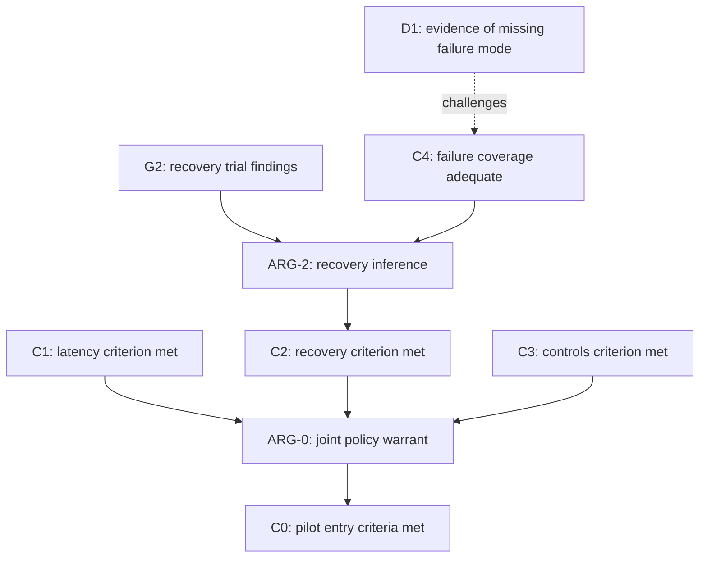

# Engineering Extended Toulmin Argument Template

Replace the bracketed fields. Complete one record for each materially distinct inference supporting a claim. Reuse canonical claim, evidence and assumption references across records. For complex cases, complete the composition overview below. Components 1–6 retain the Toulmin structure. Components 7–14 are proposed engineering extensions.

## Argument context

| Field | Entry |
| --- | --- |
| Argument identity | [ARG-identifier and revision; conclusion C-identifier] |
| Engineering question | [Question this argument answers] |
| Intended use | [Understanding, design comparison, verification, prediction, release decision or other use] |
| Claim type | [Mathematical, observational, predictive, causal, comparative or practical/normative] |
| Target identity | [System, component, algorithm or process, with relevant version/configuration] |
| Assessment boundary | [Evidence considered, applicable period and consequential exclusions] |

## Argument record

| Component | Fillable engineering entry |
| --- | --- |
| **1. Claim — C1** | **[System or artefact/version]** satisfies **[precisely defined property or requirement]** under **[specified conditions]**. For a recommendation: **[actor]** should take **[action]** to achieve **[objective]**, subject to **[constraints]**. |
| **2. Grounds — G1…Gn** | **G1:** [Finding or premise], supported by **E1:** [Evidence reference and exact location]. **G2:** [Finding or premise], supported by **E2:** [Reference]. [Identify which premises must hold jointly.] |
| **3. Warrant — W1** | Given **[grounds]** and **[assumptions]**, **[rule, mechanism, model or decision principle]** supports **[C1]** because **[explicit inferential connection]**. Inference type: **[deductive, inductive, abductive, causal, analogical or practical]**. Applicability here: **[reason]**. |
| **4. Backing — B1** | **[Proof, engineering theory, validation study, applicable research or justified decision principle]** supports **[W1]** within **[domain of applicability]**. Reference: **[source/location]**. Remaining limitation: **[limitation or none identified, with basis]**. |
| **5. Qualifier — Q1** | The warranted force of **[C1]** is **[necessarily, probably, provisionally or another justified formulation]**, on the basis of **[proof, inference or assessment method]**. Where applicable, quantified uncertainty is **[estimate/interval]**, obtained by **[method and assumptions]**. |
| **6. Rebuttal conditions — R1** | **[W1]** loses applicability when **[specific exception or boundary condition]**. Its presence would be established by **[observation or analysis]** and would require **[withdrawal, qualification or revision of the inference]**. |
| **7. Scope, definitions and criteria** | Included cases: **[operating envelope, workload, population, configurations and period]**. Terms and measures: **[operational or mathematical definitions]**. Property assessment criterion: **[threshold, tolerance, formal condition or other justified criterion]**. Transfer to other cases requires **[additional justification]**. |
| **8. Evidence provenance and adequacy** | For each **[E1…En]**, record **[source, exact artefact/location, version/date, acquisition or derivation method and result]**. Adequacy for the intended use: **[relevance, reliability, coverage and uncertainty, with reasons]**. Shared sources or methods: **[dependencies that limit independence]**. |
| **9. Critical assumptions and dependencies** | **A1:** [Assumption]. Basis for relying on it: **[evidence or justification]**. Dependent claim or inference: **[identifier]**. If it fails: **[specific consequence]**. Additional required subclaims: **[identifiers and relationship]**. |
| **10. Competing explanations or options** | Strongest relevant alternative: **[alternative explanation, model, design or action]**. It accounts for **[observations or objectives]** through **[mechanism or rationale]**. Discriminating check: **[observation or analysis]**. Comparison criterion applied to both: **[criterion]**. |
| **11. Challenges and responses** | **D1** targets **[premise, inference or conclusion identifier]** through **[undermining, undercutting or rebutting]**. Challenge: **[specific objection]**. Evidential status: **[observed finding, supported possibility or hypothetical test]**. Response and remaining effect: **[assessment]**. |
| **12. Stronger target and evidence obligations** | **C-target:** [Proposed stronger claim]. Strengthening sought: **[broader scope, stronger inferential force, greater precision, causal attribution or stronger decision justification]**. Gap: **[missing support]**. Required evidence/reasoning: **[item]**, obtained through **[method]** and assessed against **[criterion]**. Consequences of favourable, adverse and inconclusive results: **[changes to the claim]**. |
| **13. Current assessment and defensible claim** | **C-current:** [Strongest wording justified by the assessed evidence, including scope and qualifier]. Assessment: **[supported, conditional, unresolved or this argument defeated, with reasons]**. Decisive support: **[grounds and inference]**. Decisive limitation: **[gap, uncertainty or surviving challenge]**. |
| **14. Decision basis and revision triggers** | Proposed action, where relevant: **[action]**. Objective/value criterion: **[criterion]**. Feasible alternatives and constraints: **[comparison]**. Consequences of error and controls: **[risks, reversibility and mitigation]**. Action acceptance criterion: **[criterion and why it is appropriate]**. Reassess when **[evidence, assumption, configuration or operating condition changes]**. |

Use additional register rows only where they affect assessment or traceability. Mark inapplicable entries with a short reason.

## Evidence register

An evidence item can support a premise or the backing for a warrant. Record the actual relationship. Keep available evidence distinct from requested evidence.

| Evidence ID | Premise or warrant supported | Artefact, location and version/date | Method and relevant finding | Availability and verification performed | Adequacy, limitations and shared dependencies |
| --- | --- | --- | --- | --- | --- |
| E1 | [G1/W1] | [ ] | [ ] | [Available/requested; checks and outcomes] | [ ] |
| E2 | [ ] | [ ] | [ ] | [ ] | [ ] |

## Assumptions and dependencies

| ID | Assumption or required subclaim | Basis for reliance | Dependent inference or conclusion | Consequence of failure and relevant check |
| --- | --- | --- | --- | --- |
| A1 | [ ] | [ ] | [ ] | [ ] |
| A2 | [ ] | [ ] | [ ] | [ ] |

Where support depends on several premises together, state the conjunction. Where separate arguments independently support a conclusion, identify each argument and any shared assumptions or evidence.

## Challenge register

| Attack type | Target and interpretation |
| --- | --- |
| **Undermining** | A premise: [Why a supporting premise may be false or inadequately supported] |
| **Undercutting** | An inference: [Why the grounds could hold while the inference is inapplicable or unreliable here] |
| **Rebutting** | A conclusion or subclaim: [Evidence or argument supporting an incompatible conclusion] |

| Challenge ID | Target ID and attack type | Objection and supporting evidence | Evidential status | Response or discriminating check | Remaining effect |
| --- | --- | --- | --- | --- | --- |
| D1 | [ ] | [ ] | [Observed/supported possibility/hypothetical] | [ ] | [ ] |
| D2 | [ ] | [ ] | [ ] | [ ] | [ ] |

Assess whether a challenge succeeds. An imagined failure mode supplies a test proposal. An established objection supplies a reason to revise the assessment.

## Evidence obligations for the stronger target

**Current formulation:** [C-current]

**Stronger target formulation:** [C-target]

| Gap and affected inference | Required evidence or reasoning | Method, scope and comparison | Assessment criterion and its justification | Effect of favourable, adverse or inconclusive results | Priority and next action |
| --- | --- | --- | --- | --- | --- |
| [ ] | [ ] | [ ] | [ ] | [ ] | [ ] |
| [ ] | [ ] | [ ] | [ ] | [ ] | [ ] |

Choose investigations capable of changing the conclusion or decision. State assessment criteria before inspecting decisive results where practicable. A result may justify narrowing or abandoning the target as well as strengthening it.

## Assessed argument

> Because **[grounds]**, and because **[warrant]** applies under **[assumptions and scope]**, supported by **[backing]**, the available support warrants **[qualified current claim]**. The remaining consequential challenge is **[challenge or none identified, with basis]**. The stronger target **[target]** requires **[specific additional support]**.

For a consequential recommendation, add:

> Given **[objective/value criterion]**, **[constraints]** and **[consequences of error]**, **[action]** is justified by **[comparative reasoning and evidence]**. Reassessment is triggered by **[specified change]**.

## Composition overview for a complex case

**Case question:** [Question answered by the whole case]

**Top-level claim:** [C0: exact proposition, scope and qualifier]

**Shared context:** [Target version/configuration, operating envelope, definitions and assessment criteria]

**Composition warrant:** [W0: why the selected subclaims and their relationships justify C0, including coverage and relevant interactions]

**Required argument records:** [ARG-identifiers]

Use C-identifiers for propositions, ARG-identifiers for argument records, E-identifiers for evidence, A-identifiers for assumptions, W-identifiers for warrants and D-identifiers for challenges. A proposition may be a conclusion in one record and a ground in another. Several argument records may support the same proposition through different warrants or evidence.

### Claim register

| Claim ID | Exact proposition and applicable scope | Supporting argument IDs | Relevant challenges | Current assessment |
| --- | --- | --- | --- | --- |
| C0 | [Overall claim] | [ARG-0] | [ ] | [ ] |
| C1 | [Intermediate or subsidiary claim] | [ARG-1] | [ ] | [ ] |
| C2 | [Intermediate or subsidiary claim] | [ARG-2, ARG-3] | [ ] | [ ] |

### Composition register

| Argument ID | Conclusion ID | Ground claims or premises | Warrant ID | Required relationship among inputs | Scope and required assumptions |
| --- | --- | --- | --- | --- | --- |
| ARG-0 | C0 | [C1, C2, C3] | W0 | [Jointly required] | [ ] |
| ARG-1 | C1 | [G1, C4; evidence E1] | W1 | [Jointly required] | [ ] |
| ARG-2 | C2 | [G2, C5; evidence E2] | W2 | [Jointly required] | [ ] |
| ARG-3 | C2 | [G3, C6; evidence E3] | W3 | [Jointly required within this candidate alternative route] | [ ] |

The relation between ARG-2 and ARG-3 is [individually adequate alternative routes / cumulative contributions requiring a further combining argument / other stated relationship]. Assess that relationship explicitly. Distinct argument records can share data, methods or assumptions.

Grounds state propositions. Evidence references identify the artefacts supporting those propositions. A filename alone leaves the supporting finding unspecified.

### Relationship meanings

| Relationship | Representation and assessment |
| --- | --- |
| **Serial support** | ARG-1 concludes C1; another argument uses C1 as a ground. The receiving argument must establish that the imported proposition, qualifier, scope and assumptions are adequate for its inference. |
| **Joint support** | One inference requires several grounds together. The warrant must explain why that set is sufficient within the applicable context. An unresolved required ground leaves this route unresolved. |
| **Alternative routes** | Different arguments support the same claim. Treat either as sufficient only after establishing that it individually meets the applicable assessment criterion. |
| **Cumulative support** | Several contributions are jointly assessed for a claim. Add an explicit argument for combining them, including their dependencies and the basis for the combined judgement. |
| **Shared support or assumptions** | Several branches use the same evidence, intermediate claim, method or assumption. Record the shared dependency once and trace all affected uses. |
| **Attack** | A challenge targets a premise, inference or conclusion. Give a counterargument its own argument record when its reasoning requires separate assessment. |

### Composition checks

- **Coverage:** [Why these subclaims cover the requirements of C0. Which interactions or interface conditions require additional support?]
- **Compatibility:** [Why imported claims apply to the same target identity, relevant scope and definitions, or what transfer argument bridges a difference.]
- **Support conditions:** [Which input claims must hold jointly and which candidate routes are individually adequate.]
- **Shared dependencies:** [Which branches share evidence, methods, intermediate claims or assumptions, and how that affects appraisal.]
- **Conflict assessment:** [Which challenges succeed, which remain unresolved, and the reasons for preferring one conflicting argument where a preference is justified.]
- **Circularity check:** [Whether any claim depends on itself through its support chain. Specify an independently justified induction, fixed-point or other rule if one is required. A loop alone supplies no additional support.]
- **Change impact:** [Affected routes from an altered evidence item, assumption, scope condition or assessed claim to C0.]
- **Whole-case assessment:** [Strongest current C0, reasons, surviving alternatives and consequential gaps.]

Assess dependencies before their uses where the support structure permits. Support graphs can reuse nodes across branches. Attack relations can contain cycles and require assessment of the conflicting arguments together.

When a required premise becomes unresolved, revisit each dependent inference. An alternative adequate route may preserve the supported conclusion. Failure of one route does not itself establish the conclusion's negation.

Derive any quantitative confidence combination from an explicit model and its dependency assumptions. A count, average, minimum or product of argument scores acquires no justification merely from the graph structure.

### Illustrative composition

The following is fictional. Policy P is assumed to define three technical entry criteria for a limited pilot in environment K.

- **C0:** Release R meets policy P's technical pilot-entry criteria in K.
- **C1:** R meets the latency criterion in K.
- **C2:** R meets the recovery criterion in K.
- **C3:** R meets the operational-controls criterion in K.
- **C4:** The tested failure modes adequately cover the recovery requirement in K.
- **G2:** The recorded recovery trials met their specified thresholds, supported by evidence E2.
- **W0:** For this particular policy and context, C1, C2 and C3 jointly satisfy its technical entry criteria.
- **W2:** The trial findings support C2 only with an adequate coverage argument and the stated measurement and transfer assumptions.

D1 challenges the coverage premise C4. If it establishes that a required failure mode lacks adequate coverage, the existing recovery route needs revision. It leaves the recorded trial findings G2 intact. Because ARG-0 requires C2, its support for C0 also needs reassessment. A separate adequate argument for C2 could preserve support for C0.

A failed test report and an inadequate transfer from tests to operation target different parts of the case. Record their effects at the relevant nodes. Deployment authorisation requires the further practical argument appropriate to the decision.

### Whole-case conclusion template

> The assessed arguments support **[C0-current]** under **[shared scope and assumptions]** through **[argument routes and composition warrant]**. The consequential unresolved issue is **[targeted gap or challenge]**, affecting **[dependent claims/routes]**. The stronger target **[C0-target]** requires **[specific support]**. The next investigation is **[check]** because its possible results could change **[identified part of the whole-case assessment]**.

## Completion sequence

1. Specify the engineering question, target identity and proposed claim.
2. State the grounds, warrant and backing. Identify consequential assumptions.
3. Appraise the available evidence and assess serious alternatives and targeted challenges.
4. Write the strongest current formulation, with its scope and qualifier.
5. State the stronger target separately and specify investigations capable of resolving the gaps.
6. For a complex case, check the composition register, compatibility, coverage, shared dependencies and surviving support routes before assessing C0.
7. Where action is proposed, assess it against the objective, constraints and consequences of error.

## Interpretation notes

- Scope describes the cases covered. A qualifier describes the force of the inference.
- Evidence identification and source verification support appraisal. Their adequacy for the particular claim requires a separate judgement.
- Deductive soundness requires validity and true premises. Empirical claims require assessment of evidential strength, applicability and uncertainty.
- Failure of one supporting argument leaves the truth of its conclusion open unless further reasoning settles it.
- Mathematical propositions use definitions, proof obligations and counterexamples where appropriate. Empirical propositions use measurements, experiments and suitable inference.
- A practical recommendation also needs explicit objectives or value commitments and a comparison of feasible actions.
- Numerical uncertainty requires a defensible estimation method. Record an unquantified assessment when quantification lacks support.

## Basis

The six core components follow Stephen E. Toulmin, *The Uses of Argument*, updated edition, Cambridge University Press, 2003 [1958]: https://doi.org/10.1017/CBO9780511840005.

The three attack targets draw on Sanjay Modgil and Henry Prakken, “The ASPIC+ framework for structured argumentation: a tutorial”, *Argument & Computation* 5(1), 2014, pp. 31–62: https://doi.org/10.1080/19462166.2013.869766.

The engineering extensions are a proposed practical template. Apply additional domain-specific requirements when their fulfilment matters to the claim or intended decision.

For graphical composition and modular assurance arguments, see the *GSN Community Standard*, especially its sections on goal structures and modular extensions: https://www.faa.gov/sites/faa.gov/files/redac-sas-201503-GsnCommunityStandardV1.pdf. The composition records above are a proposed working extension, rather than a claim of conformance to that notation.

